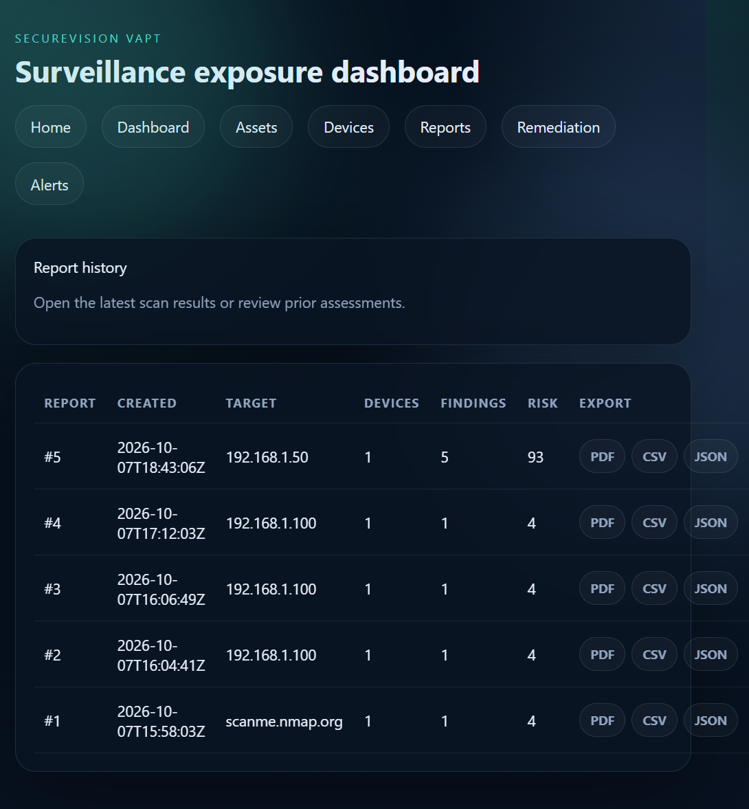
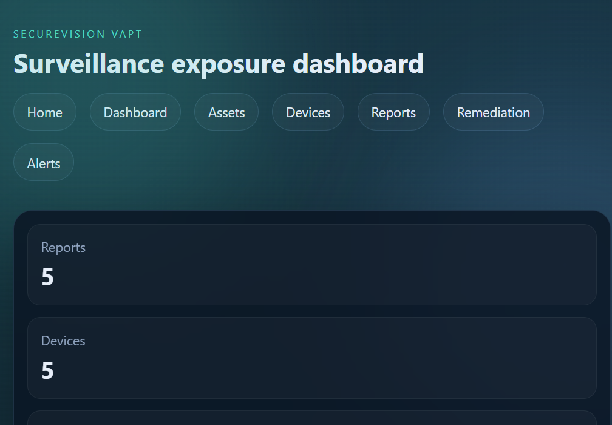

# SecureVision VAPT

> A surveillance-focused vulnerability and exposure assessment platform for authorized security testing.

[](https://securevision-vapt.onrender.com/)
[](https://www.python.org/)
[](https://flask.palletsprojects.com/)
[](https://nmap.org/)

SecureVision VAPT brings network discovery, device fingerprinting, service exposure analysis, conservative CVE correlation, deterministic risk scoring, anomaly detection, remediation guidance, historical reporting, and security exports into one workflow.

The platform is designed for:

- Authorized CCTV, DVR, NVR, and network-device assessments
- Defensive security research and academic demonstrations
- Security teams that need explainable findings and remediation priorities
- Repeatable testing through deterministic simulation when hardware is unavailable

**Live application:** [securevision-vapt.onrender.com](https://securevision-vapt.onrender.com/)

## Product at a glance

The application guides an assessor from a target list to an actionable report:

```text
Target scope
    -> Host discovery
    -> Nmap service/version detection
    -> Device fingerprinting
    -> Service, credential, and firmware analysis
    -> Evidence-based CVE correlation
    -> Rule-based risk score + ML anomaly signal
    -> Remediation recommendations
    -> Historical persistence, dashboard, API, and exports
```

### Key capabilities

| Capability | What it provides |
| --- | --- |
| Scope-aware discovery | Individual IPv4 addresses, hostnames, CIDR ranges, and comma-separated targets |
| Live Nmap assessment | TCP connect scanning with service and version detection, CPE evidence, and explicit failure reporting |
| Deterministic simulation | Repeatable CCTV profiles for demos, tests, and academic evaluation without contacting the supplied target |
| Device fingerprinting | Vendor, model, firmware, platform, device type, confidence, products, versions, and observed CPEs |
| Surveillance-aware checks | RTSP, ONVIF, Telnet, FTP, HTTP/HTTPS, and other service exposure patterns |
| Conservative vulnerability intelligence | CVE matches require sufficient product/version/service evidence; an open port is not treated as proof of a CVE |
| Risk prioritization | Explainable 0-100 severity score plus an independent Isolation Forest anomaly score |
| Remediation workflow | Technical context, business impact, attack scenario, and prioritized corrective guidance |
| Reporting and integration | Dashboard, historical reports, PDF/CSV/JSON exports, and REST API endpoints |

## Screenshots

The screenshots below were captured from the deployed application and are included as documentation assets.

<table>
  <tr>
    <td align="center" width="50%">
      <strong>Assessment dashboard</strong><br><br>
      
    </td>
    <td align="center" width="50%">
      <strong>Report history and exports</strong><br><br>
      
    </td>
  </tr>
</table>

## Assessment modes

### Simulation — repeatable academic demo

Simulation mode uses deterministic surveillance profiles selected from the target string. It does not contact the supplied address. Use it to demonstrate the full pipeline, compare profiles, and create repeatable test data.

Example target:

```text
192.168.1.50
```

### Live Nmap — authorized network only

Live mode performs real discovery and service/version detection. It never silently falls back to simulated data if Nmap fails.

Only scan systems and networks that you own or are explicitly authorized to assess.

## Risk and ML methodology

### Deterministic risk score

Findings are categorized as Critical, High, Medium, Low, or Informational and weighted as follows:

| Severity | Weight |
| --- | ---: |
| Critical | 40 |
| High | 25 |
| Medium | 12 |
| Low | 4 |
| Informational | 1 |

The aggregate score is capped at 100 to provide a simple prioritization scale.

### Isolation Forest anomaly detection

The ML layer is intentionally separate from CVE matching and the rule-based score. It extracts eleven evidence-derived features, including:

- Open, high-risk, medium-risk, and unencrypted service counts
- CVE count, maximum CVSS, and potentially exploitable CVE evidence
- Default credential exposure
- Outdated and end-of-life firmware indicators
- RTSP and ONVIF exposure

The output is an anomaly score from 0 to 100 and a Low/Medium/High priority signal. It indicates unusual exposure relative to the baseline; it does **not** prove exploitability or the existence of a vulnerability. Accuracy claims require a separately labeled dataset.

## Application areas

The Flask interface currently exposes:

- **Home:** quick scan form and latest assessment summary
- **Dashboard:** risk metrics, device exposure, findings, CVE context, and analytics
- **Assets:** persistent asset inventory and risk state
- **Devices:** device-level evidence and findings
- **Reports:** historical assessments with PDF, CSV, and JSON exports
- **Remediation:** finding-to-workflow guidance
- **Alerts:** security-event review and acknowledgement

## Architecture

```text
SecureVision VAPT
├── app.py / wsgi.py              Application entry points
├── core/                         App factory and configuration
├── api/                          Flask routes, API, exports, alerts, remediation
├── scanner/                      Discovery, Nmap, fingerprinting, CVE, scoring
│   └── plugins/                  Service-specific security checks
├── ml/                           Isolation Forest anomaly detection
├── database/                     Persistence and data models
├── templates/                    Jinja web interface
├── static/                       CSS and frontend assets
├── data/                         Vendor and credential intelligence
├── tests/                        Automated tests
├── Dockerfile                    Container runtime
└── render.yaml                   Render deployment configuration
```

### Scanner pipeline

1. Parse and validate the target scope.
2. Discover reachable hosts; for CIDR ranges, perform host discovery first.
3. Run Nmap with `-Pn -sT -sV --reason`.
4. Preserve service, product, version, state, tunnel, reason, and CPE evidence.
5. Build a conservative device fingerprint.
6. Run service plugins, credential checks, and firmware analysis.
7. Correlate CVEs only where evidence supports the match.
8. Calculate deterministic risk and ML anomaly signals.
9. Persist reports, devices, findings, assets, and alerts.
10. Present the result in the dashboard and export formats.

## Technology stack

- **Python 3.11+** — application and scanner logic
- **Flask / Jinja2** — web application and server-rendered UI
- **Nmap / python-nmap** — network and service discovery
- **scikit-learn** — Isolation Forest anomaly detection
- **SQLite locally; PostgreSQL-compatible deployment path** — persistence
- **ReportLab, Pandas, OpenPyXL** — report and data exports
- **Gunicorn** — production WSGI server
- **Docker and Render** — deployment options

## Local development

### Prerequisites

- Python 3.11 or newer
- Nmap installed and available on `PATH` for live assessments
- Git

Verify Nmap:

```bash
nmap --version
```

### Install and run

```powershell
git clone <YOUR_GITHUB_REPOSITORY_URL>
cd "SecureVision VAPT"
python -m venv .venv
.\.venv\Scripts\Activate.ps1
pip install -r requirements.txt
python app.py
```

Open [http://127.0.0.1:5000](http://127.0.0.1:5000).

The application uses local SQLite persistence by default. Copy `.env.example` to `.env` and configure environment-specific values when needed.

### Docker

```bash
docker build -t securevision-vapt .
docker run --rm -p 5000:5000 securevision-vapt
```

The Docker image installs Nmap and runs the application with Gunicorn. The included [render.yaml](render.yaml) defines the Render web service and supports an externally configured `DATABASE_URL`.

### Render deployment

The repository is configured for Render with:

- `pip install -r requirements.txt` as the build command
- `gunicorn -b 0.0.0.0:$PORT wsgi:app` as the start command
- Generated `SECRET_KEY`
- Optional `DATABASE_URL` for persistent PostgreSQL storage

The free Render filesystem is ephemeral. Do not rely on local SQLite data surviving restarts or redeployments; use a managed persistent database for production continuity.

## Testing and validation

Run the automated suite with:

```bash
pytest
```

Run the scanner integration flow with:

```bash
python -m scanner.test_nmap_flow
```

The tests cover CVE matching, simulated scan behavior, ML risk analysis, plugin discovery and execution, dashboard/report selection, and Nmap evidence preservation.

## REST API

Integration endpoints are available under `/api/v1`. The full reference is in [API_DOCUMENTATION.md](API_DOCUMENTATION.md).

Common areas include:

| Area | Examples |
| --- | --- |
| Health and statistics | `GET /api/v1/health`, `GET /api/v1/stats` |
| Assets | `GET /api/v1/assets`, `GET /api/v1/assets/<asset_id>` |
| Findings | `GET /api/v1/findings`, `GET /api/v1/findings/<finding_id>` |
| Reports | `GET /api/v1/reports`, `GET /api/v1/reports/<report_id>` |
| Devices | `GET /api/v1/devices`, `GET /api/v1/devices/<device_ip>` |

**Deployment note:** the current API does not implement authentication. Add API-key or OAuth2 protection before exposing these integration routes to an untrusted network.

## Security principles

- **Authorization first:** only assess systems within an approved scope.
- **No silent simulation:** live-mode failures remain visible to the operator.
- **Evidence over assumptions:** product-specific findings require supporting evidence.
- **Exposure is not automatically a CVE:** open RTSP, HTTP, FTP, or ONVIF services may be findings without being confirmed vulnerabilities.
- **Conservative fingerprinting:** unknown vendor, model, and firmware fields are not invented.
- **Explainable prioritization:** risk and anomaly outputs are presented as decision support, not proof of compromise.

## Limitations

- CVE coverage depends on the local vulnerability knowledge base and the quality of observed product/version evidence.
- Firmware analysis is based on maintained local vendor baselines.
- Network visibility, firewalls, authentication, and service banners affect assessment quality.
- SQLite is appropriate for development and demonstrations, not large multi-user production workloads.
- The platform is not a substitute for a full enterprise VAPT program or an authorized professional penetration test.

## Further documentation

- [API_DOCUMENTATION.md](API_DOCUMENTATION.md) — REST API reference
- [RESEARCH_PAPER_DRAFT.md](RESEARCH_PAPER_DRAFT.md) — research methodology, architecture, and evaluation draft
- [VALIDATION.txt](VALIDATION.txt) — validation notes
- [FIX_AUDIT.md](FIX_AUDIT.md) — development/fix audit
- [Dockerfile](Dockerfile) — container configuration
- [render.yaml](render.yaml) — Render service configuration

## Responsible use

SecureVision VAPT is defensive security software. Use it only against systems you own, systems for which you have written authorization, controlled laboratory targets, or intentionally provided security-testing environments. Do not scan or test third-party systems without permission.

## License

No open-source license is currently defined in this repository. Add a `LICENSE` file before publishing the project for reuse or redistribution.
